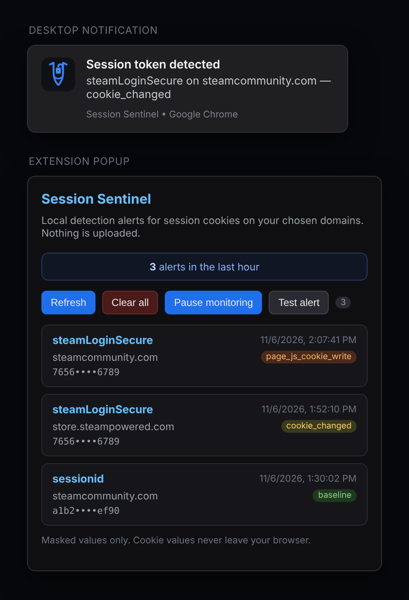

# Session Sentinel

Detection-only browser extension that alerts you when session/auth cookies
(`steamLoginSecure`, `sessionid`, `steamMachineAuth…`, `auth`, `session`,
`token`, `jwt`, …) appear, change, or are written by page JavaScript — on
**any domain you choose**. Designed to help you spot session-token
exfiltration early, after you've already had tokens stolen, or as a preventive
watchdog.

**Nothing is uploaded, exfiltrated, or sent anywhere.** All logs live in your
browser's local storage (`chrome.storage.local`) and never leave your machine.

## What an alert looks like

When a watched cookie changes you get a desktop notification — title **"Session
token detected"**, followed by the cookie name, domain, and cause. The same
detection is logged in the extension popup with a masked value and a colored
**cause** badge (`cookie_changed`, `page_js_cookie_write`, or `baseline`). To
see exactly what a detection looks like without waiting for one, click the
**Test alert** button in the popup — it fires a clearly-labeled `manual_test`
entry and touches no real cookies.

## Why this exists

Session tokens are "bearer" credentials: whoever holds them is treated as you
until they expire or are revoked. Infostealers, phishing sites, and malicious
browser extensions commonly steal these cookies from your browser's cookie
database or from live requests. This extension gives you a real-time alert when
one of those cookies appears or changes, so you can revoke sessions, change
your password, and re-secure your account before damage spreads.

It does **not** steal tokens, does **not** bypass Steam Guard, and does **not**
interact with any site's network APIs. It only observes your own browser's
cookie jar.

## What it watches

- Cookie **changes** (chrome.cookies API) on any enabled watched domain.
- Cookie **writes** by page JavaScript (`document.cookie`) on any page.
- A one-time **baseline scan** on install/startup so you can see which
  sensitive cookies already exist (marked `baseline`, not necessarily an attack).

**Two independent triggers** (either one is enough to alert):

1. **Watched domain** — the cookie is on a domain in your list (subdomains
   included). Each domain can be toggled on/off individually.
2. **Sensitive name** — the cookie name matches one of your patterns
   (prefix/contains matching), on **any** domain.

A domain you've toggled **off** silences alerts for that domain entirely, even
if the cookie name looks sensitive. This is how you quiet noisy sites while
keeping detection elsewhere.

## Quiet mode

- **On:** alerts are logged in the popup but no browser notifications fire.
  Good for running continuously on sites that legitimately set session cookies.
- **Off:** every detection shows a notification immediately.

## What it does when it sees one

1. Writes a timestamped, masked alert to local storage (cookie value is masked,
   e.g. `abcd••••…1234`, so screenshots don't leak the token).
2. Shows a browser notification (unless Quiet mode is on).
3. Lists every alert in the extension popup for review.

### Popup summary & pause

At the top of the popup there's a "Last hour" summary bar showing how many alerts fired in the last 60 minutes, plus a **Pause monitoring** button. Click it and enter minutes (1–1440) to temporarily stop alerting — stored alerts are kept, and monitoring resumes automatically when the timer runs out. You can resume early from the popup or options page.

Pause is separate from Quiet mode (options page). Pause suppresses logging too; Quiet mode still logs but suppresses browser notifications.

## Install (sideload / developer mode)

This extension is **not published to the Chrome Web Store** — cookie-reading
extensions are routinely flagged by automated review, and a rejection would look
worse than no listing. Install it yourself instead:

1. Download or clone this repo.
2. Open Chrome and go to `chrome://extensions/`.
3. Enable **Developer mode** (toggle, top right).
4. Click **Load unpacked** and select the folder containing `manifest.json`.
5. Pin the extension to your toolbar for easy access.

To update later: make changes, then click the **update** (refresh) icon on the
extension's card in `chrome://extensions/`, or reload the unpacked folder.

## Review your alerts

Click the extension icon. You'll see a list with:

- Time
- Cookie name
- Domain
- Cause (`cookie_changed`, `page_js_cookie_write`, `baseline`)
- Reason (`watched_domain` or `sensitive_name`)
- Masked value

If you see an alert you didn't trigger (especially `page_js_cookie_write` or a
new `cookie_changed` at an odd time):

1. Log out of the affected site on all devices and deauthorize sessions.
2. Change the site's password from a clean device.
3. Enable 2FA on the site if it isn't already.
4. Secure the email tied to the account (new password + 2FA).
5. Run a reputable antivirus/anti-malware scan on the PC.

## Privacy

- No network requests are made by this extension.
- No telemetry, no analytics, no crash reporting to any server.
- Alerts are stored only in your browser's local profile.
- Source is intentionally unminified and readable — audit it yourself.

## Limitations

- Content-script `document.cookie` interception cannot catch every exfiltration
  path (e.g., a malicious extension with the `cookies` permission reading the jar
  directly, or a service worker). It is one layer, not a guarantee.
- Does not revoke tokens or clean infections — it alerts; you act.
- `<all_urls>` host permission is required for all-domain coverage. This is the
  same permission set credential-stealers request, so install only from a
  trusted source and review the code before enabling.

## Publishing notes

- **Chrome Web Store:** not recommended for this tool. Automated review flags
  cookie-reading extensions frequently.
- **Firefox Add-ons:** more security-tool-friendly review culture; a Firefox
  port is planned.
- **Best distribution:** GitHub + sideload instructions (this repo). Transparent
  source is the strongest "not fringe" signal for a security tool.

## Disclaimer

Educational / defensive tooling only. Use on your own accounts and devices. The
author is not responsible for account outcomes. This extension does not
guarantee detection of all session theft.